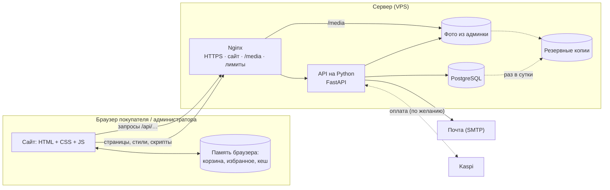

# 3. Устройство проекта

## Сравнение с обычным магазином

| В обычном магазине | В проекте | Где |
|---|---|---|
| Витрина и торговый зал | **Фронтенд** — страницы сайта в браузере | `frontend/` |
| Продавец: принимает заказ, проверяет, считает сумму | **API (бэкенд)** — программа на сервере | `backend/app/` |
| Склад и учётная книга | **База данных PostgreSQL** | на сервере |
| Охранник на входе | **Nginx** — принимает посетителей, включает HTTPS, отсекает лишних | `deploy/nginx/` |
| Сейф с ключами | **Файл настроек `deploy/.env`** — пароли и ключи | только на сервере |
| Касса | **Способы оплаты** | `backend/app/services/payments/` |

Покупатель видит только витрину. Всё важное — цены, права, заказы, пароли — проверяет «продавец» на сервере,
поэтому изменение интерфейса не даёт серверных прав и не назначает цену заказа. Это не означает отсутствия любых возможных ошибок безопасности.

## Общая схема



## Как проходит одно действие (пример — заказ)

1. Покупатель нажимает «Оформить заказ». Сайт отправляет на сервер **контакты, доставку, способ оплаты, номера товаров и количество; без доверенной клиентской цены**.
2. Nginx пропускает запрос (если не превышен лимит запросов) и передаёт его API.
3. API проверяет, кто вошёл, проверяет данные формы, берёт **цены и остатки из базы**, списывает остаток, считает доставку и итог.
4. Способ оплаты решает, что показать покупателю: реквизиты Kaspi, «оплата при получении» или страницу тестовой оплаты.
5. Ответ возвращается в браузер, сайт показывает «Спасибо за заказ!».

## Все папки проекта

```
проект/
├─ frontend/                сайт (подробно — разделы 4, 5, 6)
│  ├─ index.html, 404.html  главная и «страница не найдена»
│  ├─ pages/                остальные страницы: каталог, товар, корзина, оформление, оплата, вход, кабинет…
│  ├─ admin/index.html      админ-панель
│  ├─ css/                  оформление: base/, components/, pages/, admin/, responsive/ (адаптация)
│  ├─ js/                   поведение: app.js (загрузчик), core/, store/, components/, pages/, admin/, data/
│  ├─ texts/ru/             все надписи сайта по разделам
│  ├─ assets/images/        фото и украшения сайта
│  ├─ env.js                адрес сервера ('' — без сервера)
│  └─ favicon.svg           значок вкладки
├─ backend/                 сервер на Python (раздел 7)
│  ├─ app/                  код: core/, db/, schemas/, services/, api/, application.py, lifecycle.py, main.py, cli.py
│  ├─ migrations/           история изменений структуры базы (раздел 8)
│  ├─ tests/                проверки сервера
│  ├─ requirements*.txt     список библиотек
│  └─ Dockerfile, entrypoint.sh   как упаковать и запустить сервер в Docker
├─ deploy/                  публикация (раздел 13)
│  ├─ .env.example          образец всех настроек сервера
│  ├─ docker-compose.yml    какие программы запускаются на сервере
│  ├─ nginx/                настройки веб-сервера: адреса, HTTPS, лимиты, защитные заголовки
│  ├─ prepare_frontend.py   сборка папки .public/ — только публичные файлы сайта, стили в одном файле
│  ├─ serve_frontend.py     локальный сервер для просмотра сайта
│  └─ env.js                адрес API для сайта на сервере ('/api')
├─ demo/                    демо-версия для GitHub Pages (раздел 15), удаляется целиком
├─ tests/                   проверки логики сайта и сборки (раздел 16)
├─ docs/                    документация
├─ .github/workflows/       автоматические проверки и публикация в GitHub
├─ render.yaml              запуск на хостинге Render
└─ README.md                краткое описание проекта
```

Полная карта модулей и создаваемых данных — [22](22-Карта-папок-и-файлов.md), служебные конфигурации — [21](21-Конфигурационные-файлы.md).

## Что не хранится в проекте (и правильно)

Эти файлы создаются при работе и **не попадают в git** (правила — в файлах `.gitignore`):
настройки с паролями `deploy/.env`, локальная база `backend/dev.db`, журнал писем `backend/dev-mail.log`,
загруженные фото `backend/media/`, резервные копии `deploy/backups/`, сборка `.public/`, кеши Python, окружение `backend/.venv/`.

## Принципы, по которым разложен код

- **Одна задача — один файл.** Файлы маленькие и названы по смыслу: `cart.js` — корзина, `orders.py` — заказы.
- **Слои.** Сервер разделён на слои (настройки → база → проверка данных → бизнес-логика → адреса API), модули разделены по ответственности; зависимости нужно смотреть в import конкретного файла, строгая изоляция слоёв не обеспечивается автоматически.
- **Одна точка доступа к данным на сайте** (`App.db`): страницам всё равно, где лежат данные — в браузере или на сервере.
- **Тексты отдельно от кода** (`frontend/texts/`), настройки отдельно от кода (`frontend/js/config.js`, `deploy/.env`).
- **Адаптация отдельно** (`frontend/css/responsive/`): правила для телефона, планшета и больших экранов не смешаны с основными стилями.
