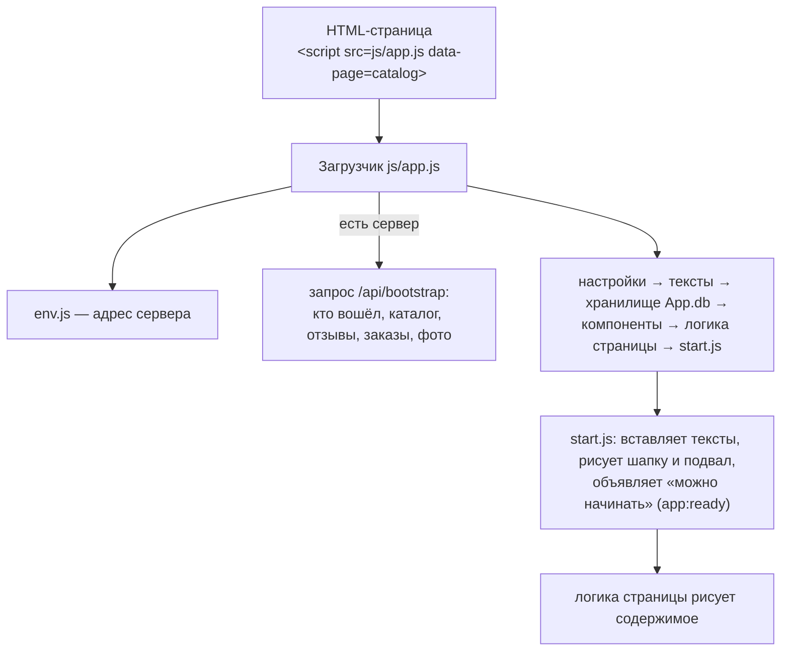

# 6. Фронтенд: JavaScript — как «оживает» сайт

## Что такое JavaScript здесь

**JavaScript (JS)** — язык программирования, который выполняется в браузере. Он рисует шапку и карточки товаров,
ведёт корзину, проверяет формы, общается с сервером, запускает анимации.

Сайт написан на **«чистом» JavaScript без фреймворков** (без React, Vue): обычные файлы, браузер открывает их сразу, без сборки.
Порядок в коде держится на договорённостях: один файл — одна задача, общий объект `App`, единая точка доступа к данным `App.db`.

## Как запускается страница

1. Каждая страница подключает **один файл** — `js/app.js` — и сообщает, какая это страница (`data-page="catalog"`).
2. Загрузчик подключает **общие файлы** (настройки, тексты, хранилище, компоненты) и **файлы этой страницы**, строго по порядку.
3. Если в `env.js` указан сервер, загрузчик одним запросом `/api/bootstrap` получает всё сразу и кладёт в память браузера.
4. Пока всё грузится, страница скрыта (не дольше 6 секунд) — посетитель не видит «мигания» недорисованной страницы.
5. `core/start.js` вставляет тексты, рисует шапку и подвал и посылает событие `app:ready` — логика страницы начинает работу.

`VERSION` в начале `app.js` и `?v=…` в HTML — номер версии файлов: его меняют при обновлении, чтобы браузеры посетителей скачали новые файлы.

## Папки `frontend/js/`

### Основа — `core/`

| Файл | Что делает |
|---|---|
| `utils.js` | Мелкие помощники: экранирование текста (защита от XSS), формат цены `12 990 ₸`, маска телефона, ссылки на страницы, поиск элементов |
| `texts.js` | `ui.t('catalog.found', {count: 5})` — достаёт текст из `texts/ru/` и подставляет значения, в т.ч. форму слова для числа («5 товаров»); вставляет тексты в разметку по меткам `data-t` |
| `icons.js` | Иконки (линейные SVG) и логотип-лотос |
| `auth-guard.js` | Пускает на оформление заказа, оплату, кабинет и админку только вошедших; гостя отправляет на вход и потом возвращает |
| `start.js` | Запуск: тексты, шапка, подвал, событие `app:ready` |

### Данные — `store/` (хранилище `App.db`)

Все страницы берут и меняют данные **только** через `App.db`. Поэтому сайт одинаково работает и с сервером, и без него.

| Файл | Что хранит |
|---|---|
| `storage.js` | Основа: чтение и запись в память браузера (`localStorage`), оповещение страниц об изменениях |
| `products.js`, `categories.js` | Товары (рейтинг, адрес `slug`, наличие) и категории |
| `users.js`, `session.js` | Пользователи, регистрация, вход; кто сейчас вошёл |
| `cart.js`, `favorites.js` | Корзина и избранное (всегда в браузере) |
| `orders.js`, `reviews.js` | Заказы и отзывы |
| `media.js` | Заменённые фото «Жизнь магазина» |
| `init.js` | Начальное заполнение пустого хранилища (категории) |
| `remote.js` | **Работа с сервером.** Если указан адрес API, подменяет методы хранилища: всё, что меняет данные, уходит на сервер, ответ обновляет кеш |

Метод «адаптер»: одна точка доступа к данным, две реализации (браузер / сервер), страницы не знают разницы.

### Повторяющиеся элементы — `components/`

| Файл | Что делает |
|---|---|
| `header.js`, `mobile-menu.js`, `footer.js` | Шапка с поиском и счётчиками, мобильное меню ≡, подвал |
| `product-card.js` | Карточка товара (два фото для наведения, звёзды, бейджи «Хит», «−15%») |
| `carousel.js` | Карусели: стрелки, листание пальцем, автопрокрутка |
| `cart-favorites-actions.js` | Кнопки «В корзину» и ♡ на любой странице, счётчики в шапке |
| `images.js` | Картинки с заглушкой, если файла нет; украшения-веточки; блок «пусто» |
| `lightbox.js` | Просмотр фото на весь экран: стрелки, свайп, Esc |
| `modal.js`, `toast.js` | Окна («Вы уверены?») и всплывающие уведомления |
| `reveal.js` | Появление блоков и раскрытие фото при прокрутке |
| `transitions.js` | Плавные переходы между страницами, «полёт» товара в корзину |
| `benefits.js` | Блок из трёх преимуществ |
| `payment-info.js` | Блок оплаты заказа: реквизиты Kaspi или кнопка «Перейти к оплате» |

### Логика страниц — `pages/`

| Файлы | Страница |
|---|---|
| `home.js` | Главная: первый экран, карусели, круги категорий |
| `catalog.js` + `catalog-state.js`, `catalog-filters.js`, `catalog-toolbar.js`, `catalog-results.js` | Каталог: фильтры хранятся в адресе страницы; боковая панель; сортировка и цена; «Найдено», страницы |
| `product.js` + `product-gallery.js`, `product-info.js`, `product-reviews.js`, `product-review-form.js`, `product-seo.js` | Товар: галерея, вкладки, отзывы, форма отзыва, данные для поисковиков (schema.org) |
| `cart.js`, `checkout.js`, `pay.js` | Корзина, оформление заказа, тестовая оплата |
| `login.js` | Вход, регистрация, подтверждение почты, сброс пароля |
| `account.js` + `account-views.js` | Личный кабинет |
| `about.js`, `delivery.js`, `favorites.js` | «О нас» (мозаика), доставка, избранное |

### Админка — `admin/`

`admin-app.js` — каркас: проверка прав, меню, переключение разделов по адресу (`#products`, `#orders`).
Разделы: `dashboard.js` (обзор), `products-list.js`, `product-form.js` + `product-form-template.js` + `product-images.js` + `form-controls.js` (товары),
`categories.js`, `orders.js`, `users.js`, `reviews.js`, `site-photos.js` (фото «О нас»), `settings.js` (готовность к запуску, экспорт),
`image-tools.js` (уменьшение фото перед загрузкой).

### Прочее

- `config.js` — настройки магазина: название, почта, адрес, бесплатная доставка, `adminEmails` (для режима без сервера).
- `data/categories.js` — стартовые категории.
- `env.js` (рядом с `index.html`) — адрес сервера.

## Тексты — `frontend/texts/ru/`

Все надписи сайта по файлам-разделам: `common.js` (шапка, подвал, кнопки, ошибки), `home.js`, `catalog.js`, `product.js`, `about.js`,
`delivery.js`, `cart.js`, `checkout.js`, `pay.js`, `login.js`, `account.js`, `favorites.js`, `not-found.js`.
В админке тексты не редактируются — только в этих файлах ([раздел 12](12-Тексты-фото-и-частые-правки.md)).
Для нового языка копируют `ru` в, например, `kk`, переводят все ключи, согласуют `lang` HTML, форматирование и серверные сообщения. Готового переключателя языка нет.

Основы событий, функций и async/await — [19](19-Основы-HTML-CSS-JS-Python.md). Контракты API — [24](24-API-и-форматы-данных.md).

## Как сайт общается с сервером

- Адрес сервера — `frontend/env.js`. Каждый запрос идёт на `<адрес>/…` в формате JSON.
- После входа сервер выдаёт **токен** — он хранится в браузере и прикладывается к каждому запросу в заголовке `Authorization`.
- Если сервер ответил ошибкой, сайт показывает её текст в уведомлении (сообщения сервера — на русском).
