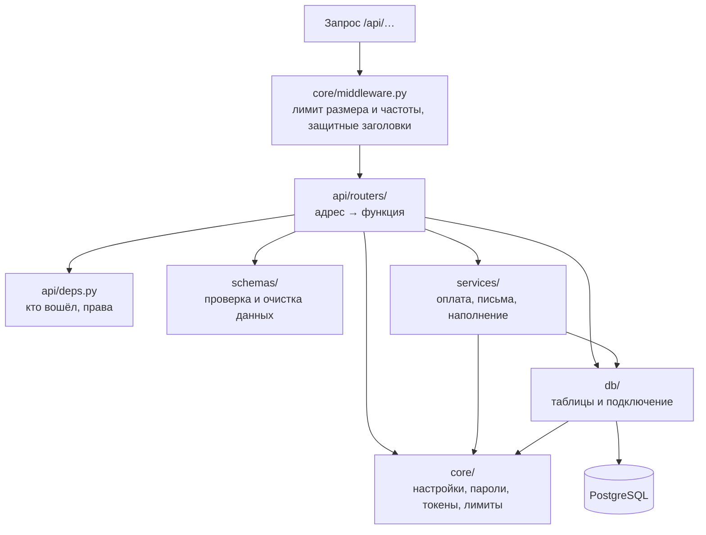

# 7. Бэкенд: Python и библиотеки

**Бэкенд** — программа на сервере. Сайт отправляет ей запросы («дай товары», «оформи заказ»), она проверяет права и данные,
работает с базой и отвечает. Написана на **Python 3.11** с библиотекой **FastAPI**. Код — в `backend/app/`.

## Библиотеки и зачем каждая

Список — в `backend/requirements.txt` (для запуска) и `backend/requirements-dev.txt` (+ для тестов). Версии закреплены:
прямые зависимости закреплены, но полного lock-файла транзитивных зависимостей нет. Точные записи requirements и назначение инструментов — [20](20-Библиотеки-и-инструменты.md).

| Библиотека | Что делает простыми словами |
|---|---|
| **FastAPI** | Основа сервера: принимает запросы по адресам `/api/…`, проверяет входящие данные, сама пишет документацию API |
| **Starlette** | «Двигатель» под FastAPI: запросы, ответы, раздача фото, промежуточные проверки (middleware) |
| **Pydantic / pydantic-settings** | Описание и проверка данных: какие поля, длина, формат. Чтение настроек из `.env` |
| **email-validator** | Проверка, что почта написана правильно |
| **Uvicorn** | Запускает сервер (принимает подключения) |
| **Gunicorn** | Запускает несколько копий сервера на настоящем хостинге и перезапускает упавшие |
| **SQLAlchemy** | Работа с базой из кода Python без ручного SQL — и защита от SQL-инъекций |
| **asyncpg** | Подключение к PostgreSQL |
| **aiosqlite** | Подключение к SQLite — маленькой базе-файлу для запуска на своём компьютере и для тестов |
| **Alembic** | Применяет записанную историю изменений схемы; влияние каждой миграции на данные проверяется перед запуском |
| **bcrypt** | Хеширование паролей (пароли не хранятся в открытом виде) |
| **httpx** | Запросы к внешним сервисам (Kaspi Pay) |
| **aiosmtplib** | Отправка писем с кодами через почтовый сервер (SMTP, например Gmail) |
| **pytest, pytest-asyncio** | Автоматические проверки (только для разработки) |

Почему FastAPI: современный и быстрый, асинхронный (обслуживает много запросов одновременно, пока ждёт базу или почту),
правила для данных описываются один раз — проверка и документация получаются сами.

## Слои сервера

| Слой | Отвечает за | Не делает |
|---|---|---|
| `core/` | Настройки, криптография, лимиты, очистка ввода, защитный слой | Не знает о таблицах и адресах |
| `db/` | Подключение к базе, таблицы с ограничениями | Не проверяет права |
| `schemas/` | Что можно прислать: типы, длины, форматы | Не обращается к базе |
| `services/` | Оплата, письма, стартовое наполнение | Не читает запросы |
| `api/` | Адреса `/api/…`, права, вызов сервисов, формат ответа | Не хранит настройки |

## Каждый файл `backend/app/`

| Файл | Что внутри |
|---|---|
| `main.py` | Точка входа Uvicorn: создаёт приложение через фабрику |
| `application.py` | Сборка слоёв: FastAPI, middleware, CORS, роутеры и media |
| `lifecycle.py` | Проверка настроек, подготовка локальной БД, администратора и закрытие соединений |
| `api/routers/health.py` | `/api/health`: проверка доступности базы с ответами 200 или 503 |
| `cli.py` | Служебные команды (см. ниже) |
| `core/config.py` | **Все настройки сервера** и значения по умолчанию; проверка `problems()` — что настроено небезопасно |
| `core/security.py` | Хеширование паролей (bcrypt), правила пароля, токены входа, коды из писем |
| `core/rate_limit.py` | Ограничение числа попыток (вход, письма, регистрации, заказы) и определение IP посетителя |
| `core/sanitize.py` | Удаление управляющих символов, проверка адресов картинок (только http/https/свой сайт) |
| `core/middleware.py` | Защитные заголовки, лимит размера запроса, общий лимит запросов, ошибки без подробностей |
| `db/session.py` | Подключение к базе: пул соединений, таймаут запросов, шифрование (SSL) |
| `db/models.py` | Таблицы: пользователи, сессии, коды, категории, товары, отзывы, голоса, заказы, настройки сайта |
| `schemas/*.py` | Правила для входящих данных по разделам: аккаунт, каталог, заказы, отзывы, сайт |
| `services/emails.py` | Письма с кодами: настоящая отправка (SMTP) или запись в журнал на своём компьютере |
| `services/payments/` | Способы оплаты ([раздел 10](10-Оплата.md)) |
| `services/seed.py` | Стартовые категории из `frontend/js/data/categories.js` |
| `api/deps.py` | «Кто вошёл» по токену, проверка прав администратора |
| `api/serializers.py` | Как записи базы отдаются сайту (в тех же полях, что использует сайт) |
| `api/routers/auth.py` | Аккаунт |
| `api/routers/catalog.py` | Категории, товары, загрузка фото |
| `api/routers/orders.py` | Заказы, способы оплаты, тестовая оплата, уведомления Kaspi |
| `api/routers/reviews.py` | Отзывы |
| `api/routers/site.py` | Пользователи (админка), фото «О нас», `/bootstrap`, готовность к запуску |

## Адреса API

Схема с возможностью попробовать — `/api/docs` (локально включена, в production по умолчанию выключена). Полная карта, включая исключённый из OpenAPI webhook, поля и ошибки — [24](24-API-и-форматы-данных.md).

| Адрес | Что делает | Кто может |
|---|---|---|
| `POST /api/auth/register` | Регистрация, письмо с кодом | все |
| `POST /api/auth/verify`, `/resend` | Подтвердить почту кодом / прислать код ещё раз | все |
| `POST /api/auth/login` | Вход по почте и паролю | все |
| `POST /api/auth/logout`, `/logout/all` | Выход / выход на всех устройствах | вошедший |
| `GET`, `PATCH`, `DELETE /api/auth/me` | Профиль, изменить, удалить аккаунт | вошедший |
| `POST /api/auth/password/change` | Сменить пароль | вошедший |
| `POST /api/auth/password/forgot`, `/reset` | Сброс пароля по коду из письма | все |
| `GET /api/categories`, `/products`, `/products/{id}` | Каталог | все |
| `PUT /api/categories`; `POST`, `PUT`, `DELETE /api/products…`; `POST /api/uploads` | Изменить каталог, загрузить фото | администратор |
| `GET /api/payments/methods` | Включённые способы оплаты | все |
| `POST /api/orders`, `GET /api/orders/my` | Оформить заказ, мои заказы | вошедший |
| `POST /api/payments/sandbox/{заказ}` | Тестовая оплата своего заказа | вошедший |
| `GET`, `PATCH`, `DELETE /api/admin/orders…` | Все заказы, статус и оплата | администратор |
| `GET /api/reviews`, `POST /api/products/{id}/reviews`, `POST /api/reviews/{id}/vote` | Отзывы, оставить, «полезно» | все / вошедший |
| `PATCH …/status`, `POST …/reply`, `DELETE /api/reviews/{id}` | Скрыть, ответить, удалить | администратор (удалить — и автор) |
| `GET`, `PATCH`, `DELETE /api/admin/users…` | Пользователи | администратор |
| `GET /api/site`, `PUT /api/site/photos` | Фото «О нас» | все / администратор |
| `GET /api/bootstrap` | Всё для открытия страницы одним запросом | все |
| `GET /api/admin/system` | Готовность к запуску (без секретов) | администратор |
| `POST /api/payments/kaspi/webhook` | Уведомление от Kaspi Pay об оплате | только с верной подписью |
| `GET /api/health` | Сервер и база работают | все |

## Служебные команды

Из папки `backend` (на сервере — через `docker compose … exec backend …`):

| Команда | Что делает |
|---|---|
| `python -m app.cli check` | Показывает, что настроено, а чего не хватает (без вывода паролей) |
| `python -m app.cli secret` | Генерирует случайный `SECRET_KEY` |
| `python -m app.cli hash-password` | Хеш пароля администратора для `ADMIN_PASSWORD_HASH` |
| `python -m app.cli seed` | Добавляет стартовые категории |
| `python -m app.cli admin` | Применяет администратора из `.env` прямо сейчас |

## Настройки

Все поля Settings описаны в `backend/app/core/config.py`; шаблон основных настроек — `deploy/.env.example`. Полный справочник defaults и приоритетов — [23](23-Переменные-окружения.md).
- **На своём компьютере** (`ENVIRONMENT=development`, по умолчанию) ничего настраивать не нужно: база — `backend/dev.db`,
  администратор — `admin@demo.kz` / `admin12345`, письма — в `backend/dev-mail.log`, включена тестовая оплата.
- **На сервере** (`ENVIRONMENT=production`) всё берётся из `deploy/.env` или панели хостинга. Если пароль короткий,
  нет `SECRET_KEY`, не указана почта для писем или включённый способ оплаты не настроен — **сервер не запустится** и напишет, что исправить.
