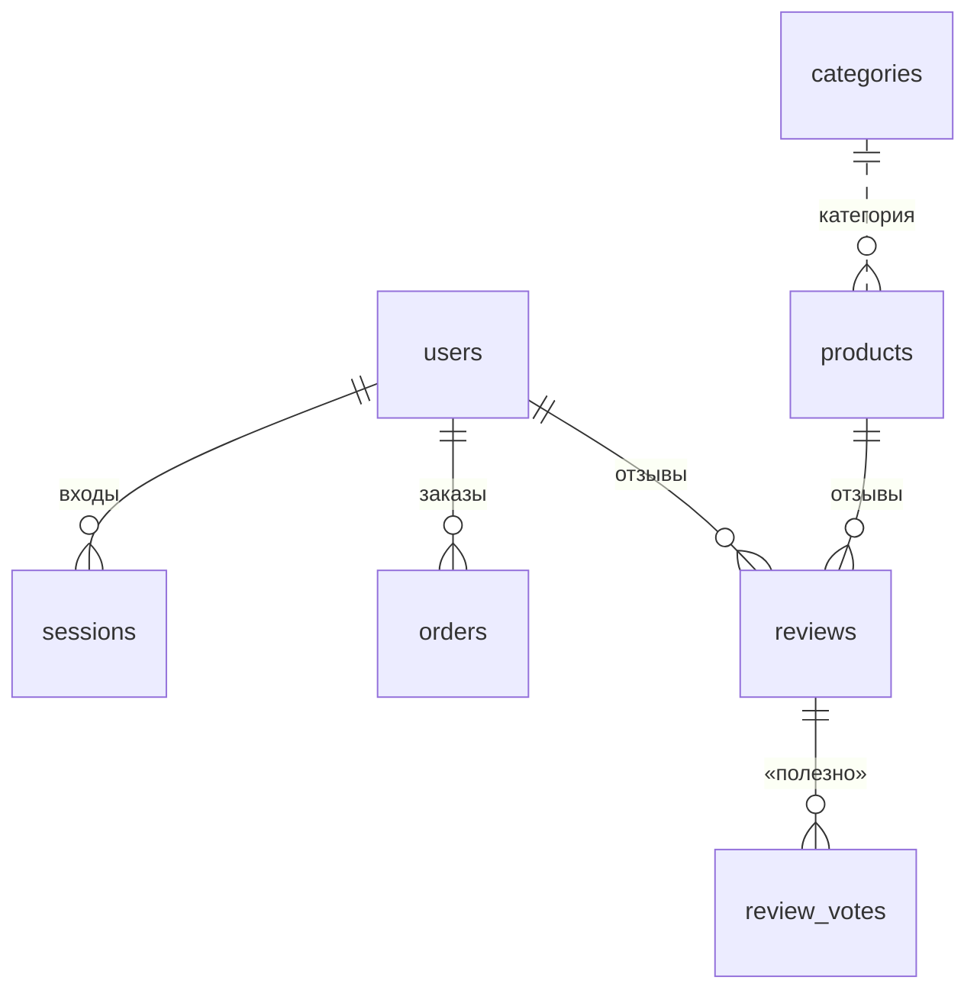

# 8. База данных

**База данных** — упорядоченное хранилище записей магазина: товаров, заказов, пользователей.
На сервере это **PostgreSQL** — надёжная бесплатная база, стандарт для интернет-магазинов.
На своём компьютере и в тестах вместо неё используется **SQLite** — та же структура в одном файле `backend/dev.db`.

Код описания таблиц — `backend/app/db/models.py`, подключение — `backend/app/db/session.py`.

## Таблицы

| Таблица | Что хранит | Главные поля |
|---|---|---|
| `users` | Покупатели и администратор | почта (уникальная), имя, телефон, **хеш пароля**, роль (`customer`/`admin`), почта подтверждена, заблокирован |
| `sessions` | Активные входы | **отпечаток токена** (SHA-256), пользователь, срок действия (30 дней) |
| `email_codes` | Коды из писем | почта, назначение (`verify` — подтверждение, `reset` — сброс пароля), **отпечаток кода**, попытки, срок (10 минут) |
| `categories` | Категории | адрес (`herbs`), название, значок, порядок, подкатегории (JSON) |
| `products` | Товары | адрес (`slug`, уникальный), название, бренд, категория, **цена**, старая цена, **остаток**, статус (на сайте / скрыт), остальное — описание, состав, фото, свои разделы (поле `data` в JSON) |
| `reviews` | Отзывы | товар, автор, оценка 1–5, текст, достоинства, недостатки, «покупка подтверждена», статус, ответ магазина |
| `review_votes` | Голоса «Полезно» | отзыв, идентификатор голосующего (одна запись на сочетание отзыв + voter; это не доказательство уникальности человека) |
| `orders` | Заказы | номер (с 1001), покупатель, контакты, доставка, состав (JSON), суммы, способ и **статус оплаты**, статус заказа |
| `site_settings` | Настройки сайта | заменённые в админке фото «О нас» |

**Почему у товара часть полей в JSON:** цена, остаток и статус — отдельные колонки (по ним идут проверки и фильтры), а описание,
состав, применение и «свои разделы» — в одном поле. Новые разделы карточки не требуют менять структуру базы.

## Связи и удаление

- Удалили аккаунт → его **сессии удаляются**, а **заказы и отзывы остаются** без привязки к аккаунту (магазину нужна история продаж).
- Удалили товар → удаляются его отзывы и голоса.
- Удалили отзыв → удаляются голоса «полезно» к нему.

## Защита данных в самой базе

Даже если в коде появится ошибка, база не примет неправильные данные — это **ограничения (CHECK)**:
- цена, старая цена, остаток, суммы заказа — не меньше 0;
- оценка отзыва — только от 1 до 5, «полезно» — не меньше 0;
- роль — только `customer` или `admin`, почта — только строчными буквами;
- статусы товара, отзыва, заказа, оплаты и назначение кода — только из разрешённого списка;
- почта пользователя и адрес товара — уникальны.

Для частых запросов созданы **индексы** (как алфавитный указатель в книге): по почте, адресу товара, категории, сроку сессии, дате заказа.

Подключение тоже защищено:
- все запросы строит SQLAlchemy **с параметрами**: введённые данные никогда не становятся частью SQL-команды, это отделяет значения от SQL-кода в реализованных запросах; новые запросы также должны сохранять параметризацию;
- слишком долгий запрос прерывается через 15 секунд (`statement_timeout`);
- число соединений ограничено (пул);
- для облачной базы можно включить шифрование (`DB_SSL=true`);
- на сервере база находится во **внутренней сети Docker**, к ней нельзя подключиться из интернета.

## Миграции

**Миграция** — записанное изменение структуры базы. Они лежат в `backend/migrations/versions/` и применяются по порядку:

| Файл | Что делает |
|---|---|
| `20261014_…_initial.py` | Создаёт все таблицы |
| `20261014_…_constraints.py` | Добавляет ограничения CHECK и индексы |
| `20261015_…_remove_google_and_code_login.py` | Убирает остатки входа через Google и по коду из письма |

На сервере миграции применяются **сами при каждом запуске** (`alembic upgrade head` в `backend/entrypoint.sh`) — влияние конкретной миграции на данные нужно проверить заранее и сохранить копию.
Откатить последнюю: `alembic downgrade -1`. Проверить, что миграции совпадают с кодом таблиц: `alembic check`.

Добавить поле или таблицу: поменять `app/db/models.py` → `alembic revision --autogenerate -m "что изменилось"` →
проверить созданный файл → `alembic upgrade head`.

## Резервные копии

На сервере контейнер `backup` **раз в сутки** сохраняет в `deploy/backups/`:
- копию базы `kbch-ДАТА.dump`;
- архив загруженных фото `media-ДАТА.tgz`.

Копии старше `BACKUP_KEEP_DAYS` (по умолчанию 14 дней) удаляются. Папку `deploy/backups/` нужно регулярно копировать за пределы сервера.
Восстановление и ручная копия — в [разделе 13](13-Публикация-на-сервере.md) и [разделе 14](14-Запуск-за-час.md).
