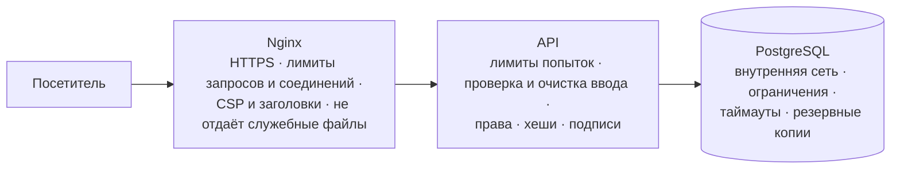

# 9. Безопасность

Что защищено, где это сделано и как проверяется. Часть механизмов проверяется в `backend/tests/test_security.py` и других серверных наборах
(запуск — [раздел 16](16-Тесты-и-проверка-качества.md); в GitHub тесты идут автоматически на SQLite и на PostgreSQL).

## Защита работает на трёх рубежах

## Угрозы и защита

| Угроза | Защита | Где в коде |
|---|---|---|
| **SQL-инъекции** | Все запросы к базе — через SQLAlchemy с параметрами: введённое никогда не становится частью SQL-команды. Входные данные проверяются схемами (длина, формат, допустимые символы) | `backend/app/db/`, `backend/app/schemas/` |
| **XSS** (чужой скрипт на странице) | Всё, что вводят люди, сайт выводит экранированным (HTML не работает). Ссылки `javascript:` и `data:` в фото запрещены. Тексты сайта меняются только в файлах, не через админку. Политика CSP запрещает встроенные и чужие скрипты | `frontend/js/core/utils.js`, `backend/app/core/sanitize.py`, CSP в каждом HTML и в Nginx |
| **Перебор паролей и кодов** | Лимиты попыток на IP и на почту, не больше 5 попыток ввода кода, коды живут 10 минут, пауза между письмами. Проверка пароля занимает одинаковое время для существующих и несуществующих аккаунтов | `backend/app/core/rate_limit.py`, `backend/app/api/routers/auth.py` |
| **DDoS / флуд** | Nginx: лимит запросов и соединений с IP, обрыв медленных соединений. API: общий лимит запросов, лимит размера запроса (1 МБ, фото — 8 МБ), таймаут запросов к базе | `deploy/nginx/security.conf`, `backend/app/core/middleware.py` |
| **Кража базы** | Пароли — только хеш bcrypt, токены входа — только отпечаток SHA-256, коды из писем — HMAC. Это затрудняет использование украденной базы, но слабые пароли могут подбираться; риск зависит также от доступа к окружению и секретам | `backend/app/core/security.py` |
| **Доступ к базе** | PostgreSQL во внутренней сети Docker без доступа извне, отдельный пароль, ограничения CHECK, ежедневные копии | `deploy/docker-compose.yml`, `backend/app/db/` |
| **Чужие права** | Каждый адрес админки проверяет роль на сервере; роль нельзя передать в запросе; администратор задаётся только в `deploy/.env` | `backend/app/api/deps.py` |
| **CSRF** | Вход по токену в заголовке `Authorization`, cookie не используются; CORS ограничивает чтение ответов браузером с других origin; серверные права отдельно проверяются по токену | `backend/app/application.py` |
| **Встраивание сайта в чужую страницу** | `X-Frame-Options: DENY`, `frame-ancestors 'none'` | Nginx, middleware |
| **Подмена цены** | Сумму считает сервер по ценам из базы; остаток проверяется с блокировкой строки — два покупателя не купят последнюю штуку дважды | `backend/app/api/routers/orders.py` |
| **Чужой заказ в оплате** | Тестовую оплату можно провести только по своему заказу; номер карты не сохраняется — только последние 4 цифры | `backend/app/services/payments/sandbox.py` |
| **Поддельное уведомление об оплате** | Подпись HMAC, сверка суммы, повторы игнорируются | `backend/app/services/payments/kaspi_pay.py` |
| **Вредный файл под видом фото** | Тип файла проверяется по содержимому (сигнатуре JPG/PNG/WEBP), имя придумывает сервер | `backend/app/api/routers/catalog.py` |
| **Утечка секретов** | Секреты — только в `deploy/.env` (не в git), не печатаются в журналах, не попадают в ответы API; ошибки отдаются без подробностей | `backend/app/core/config.py`, `backend/app/core/middleware.py` |
| **Небезопасный запуск** | В рабочем режиме сервер не стартует со слабым `SECRET_KEY`, коротким паролем администратора, без PostgreSQL, без почты, с `CORS=*`; документация API выключена | `problems()` в `backend/app/core/config.py` |
| **Подмена IP** | IP посетителя берётся из заголовка, который ставит наш Nginx, а не из присланного посетителем | `client_ip()` в `backend/app/core/rate_limit.py` |
| **Служебные файлы** | Публикуется только `.public/` — страницы, стили, скрипты, картинки; Nginx не отдаёт `.env`, `.git`, `*.md`, `*.py`, копии базы | `deploy/prepare_frontend.py`, `deploy/nginx/` |

## Как хранятся пароли

Пароль не хранится вообще — хранится **хеш bcrypt**: «отпечаток», из которого пароль восстановить нельзя.
При входе введённый пароль снова превращается в отпечаток и сравнивается. К каждому паролю добавляется случайная **соль**,
поэтому одинаковые пароли дают разные отпечатки. bcrypt намеренно медленный (12 раундов) — стоимость перебора выше, чем у быстрых хешей, но срок подбора зависит от стойкости пароля и оборудования.

Правила пароля: не короче 8 символов (у администратора — 12), не из списка частых («12345678», «password»), не содержит часть почты.

## Учётная запись администратора

- Почта и пароль — **только** в `deploy/.env` на сервере (или в панели Render).
- Надёжнее хранить не пароль, а его хеш: `python -m app.cli hash-password` → `ADMIN_PASSWORD_HASH`.
- При каждом запуске сервер приводит аккаунт администратора в соответствие с `.env`; у других аккаунтов роль администратора снимается.
- Администратора нельзя удалить или заблокировать через сайт.

## Заголовки безопасности

| Заголовок | Значение |
|---|---|
| `Content-Security-Policy` | Сайт: скрипты только свои, шрифты — Google Fonts, без встраивания в чужие страницы. API: `default-src 'none'` |
| `Strict-Transport-Security` | только HTTPS, 1 год |
| `X-Content-Type-Options` | `nosniff` — браузер не «угадывает» тип файла |
| `X-Frame-Options` | `DENY` |
| `Referrer-Policy` | Nginx: strict-origin-when-cross-origin (чужому origin передаётся origin без пути); API: no-referrer |
| `Permissions-Policy` | камера, микрофон, геолокация отключены |
| `Cache-Control: no-store` | ответы API (токены, личные данные) не кешируются |

> На странице `frontend/404.html` есть небольшой встроенный скрипт. Он разрешён по отпечатку (хешу) в CSP — в самой странице и в `deploy/nginx/headers.conf`.
> Если поменять этот скрипт, хеш нужно пересчитать, иначе браузер его заблокирует.

## Ограничения частоты запросов (по умолчанию)

| Что | Лимит | Настройка в `deploy/.env` |
|---|---|---|
| Вход с одного IP | 10 в минуту | `RATE_LOGIN` |
| Попытки входа в один аккаунт | 5 в минуту | `RATE_LOGIN_EMAIL` |
| Письма с кодами | 5 в минуту (и не чаще раза в минуту на почту) | `RATE_CODES` |
| Регистрации с одного IP | 5 в час | `RATE_REGISTER` |
| Заказы, отзывы, голоса, загрузки | 60 в минуту | `RATE_WRITE` |
| Все запросы к API с одного IP | 300 в минуту | `RATE_GLOBAL` |
| Nginx: страницы / API / вход | 30 / 10 в секунду / 10 в минуту | `deploy/nginx/security.conf` |

Превышение — ответ «Слишком много попыток» (код 429) с временем ожидания.

## Чек-лист перед запуском

- [ ] `deploy/.env` заполнен, `python -m app.cli check` — без ✗
- [ ] `SECRET_KEY` и `POSTGRES_PASSWORD` — случайные и нигде больше не используются
- [ ] пароль администратора ≥ 12 символов (лучше — `ADMIN_PASSWORD_HASH`)
- [ ] письма приходят (зарегистрируйте тестовый аккаунт)
- [ ] сайт открывается по `https://`, `http://` перенаправляет на `https://`
- [ ] в `deploy/backups/` появилась первая копия базы и фото
- [ ] на сервере открыты только порты 22, 80, 443 (`ufw allow OpenSSH && ufw allow 80 && ufw allow 443 && ufw enable`), вход по SSH — по ключу
- [ ] копии `deploy/backups/` регулярно забираются на другой компьютер
- [ ] когда подключите настоящую оплату — уберите `test_card` и `test_kaspi` из `PAYMENT_METHODS`

## Границы механизмов

Лимиты API хранятся в памяти отдельного процесса, не объединяются между worker и сбрасываются при перезапуске. Nginx ограничивает запросы, но не защищает от насыщения внешнего канала распределённой атакой. Bearer-токен в localStorage доступен JavaScript данного origin, поэтому предотвращение XSS остаётся важным. Проверка сигнатуры изображения не равна полной проверке его содержимого.

Эти меры описывают реализацию, а не сертификат безопасности или результат отдельного полного аудита. Команды тестов и границы выполненных проверок — [16](16-Тесты-и-проверка-качества.md).
